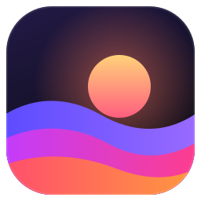
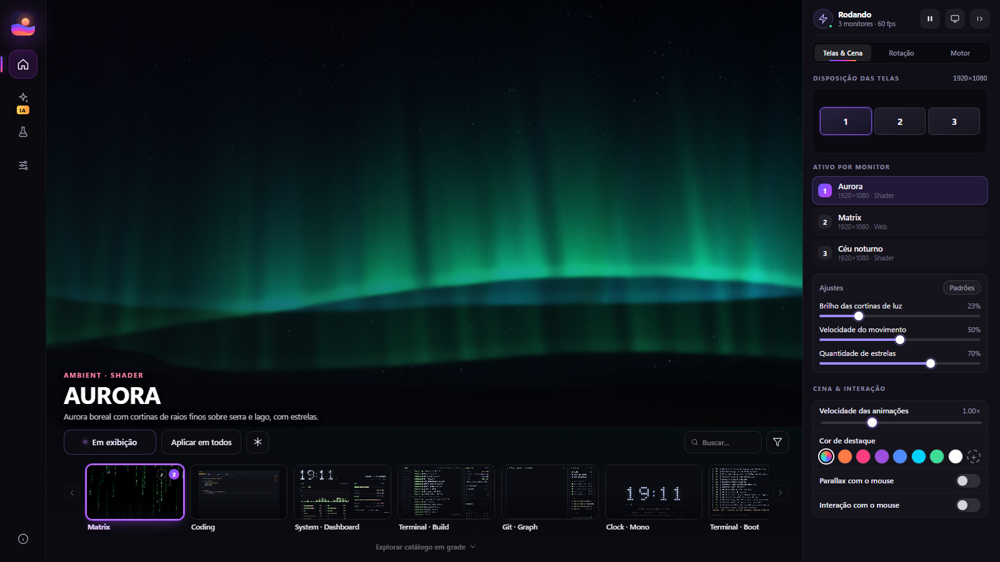

<p align="center"></p>

<h1 align="center">IsNotAEngine</h1>

<p align="center">
  Wallpapers animados nativos para Windows, escritos em Rust.<br>
  Um wallpaper diferente em cada monitor, direto na GPU, com consumo mínimo.
</p>

<p align="center">
  
  
  
  
  
</p>

> O nome é piada. A engenharia não.

<p align="center"></p>

## Destaques

- **Um app, cada monitor.** Shader, vídeo, página HTML/WebGL ou imagem, independentes por monitor, cada um com pausa e qualidade próprias.
- **Renderização na GPU.** Shaders HLSL em Direct3D 11 com DirectComposition, atrás dos ícones da área de trabalho.
- **Studio.** Interface em WebView2 com prévias renderizadas pelo próprio motor, playlist, agenda por horário, editor de cores e tour inicial.
- **Reativo.** Áudio do sistema (WASAPI loopback, 16 bandas), relógio, mouse e parallax chegam aos shaders no `cbuffer`.
- **Leve por padrão.** Pausa sozinho quando uma janela cobre o monitor, na bateria e em jogos (modo desempenho com EcoQoS).
- **Criar com IA.** Descreva o wallpaper e a IA escreve um shader, uma página ou uma imagem 4K. Usa a **sua** chave (Claude, Gemini ou OpenRouter); opcional.
- **Aberto a automação.** Servidor MCP (`--mcp`) e named pipe de controle para docks e scripts.
- **Privado.** Sem conta, sem telemetria, wallpapers sem acesso à rede (CSP `connect-src 'none'`).

## Instalação

Pegue o instalador ou o `.zip` portátil na página de [Releases](../../releases), ou instale pela Microsoft Store.

**Requisitos:** Windows 10 (2004) ou superior / Windows 11, 64 bits, e o WebView2 Runtime (já presente no Windows 11).
Testado com 3 monitores e docks customizados.

## Compilar

Requer a toolchain **MSVC** (fixada em `rust-toolchain.toml`) e o Visual Studio Build Tools com C++.

```powershell
cargo run                       # motor com ícone na bandeja
cargo run -- --studio           # já abre o Studio
cargo build --release           # binário otimizado

cargo test
cargo clippy --locked --all-targets -- -D warnings   # o mesmo comando do CI
cargo fmt
```

Flags úteis: `--fps=60`, `--mode=hwnd` (padrão: `dcomp`), `--no-pause-covered`, `--mcp`, `--lab`, `--render-previews <pasta> [id...]`.
Rodando a partir da raiz do repositório, os shaders de `assets/wallpapers/shaders/` recompilam ao salvar (hot-reload).

## Catálogo

17 wallpapers embutidos no executável, então funcionam de qualquer pasta:

| Tipo | Wallpapers |
| --- | --- |
| Shaders (9) | `aurora`, `night_sky`, `topo_dark`, `rain_glass`, `liquid_chrome`, `plasma_flow`, `smoke`, `ocean`, `gyroid_silk` |
| Web (8) | `matrix`, `coding`, `system`, `terminal_build`, `git_graph`, `clock_mono`, `terminal_boot`, `descriptografia` |

Vídeos de fábrica ficam em `assets/wallpapers/videos/` (veja o [README da pasta](assets/wallpapers/videos/README.md)). Você também importa `.hlsl`, vídeos (`mp4`, `webm`, `mkv`...), imagens, páginas e pacotes `.livewallpaper` por arrastar e soltar. Shaders do Shadertoy (GLSL `mainImage`) são convertidos para o contrato HLSL.

## Estrutura do repositório

| Pasta | Conteúdo |
| --- | --- |
| `src/` | O app: motor, render D3D11, Studio, IA, MCP, pipe de controle |
| `assets/` | Marca e biblioteca de wallpapers (shaders, páginas web, modelos) |
| `docs/` | Guias e referências; `docs/internal/` guarda roadmap e projetos internos |
| `installer/` | Instalador Inno Setup |
| `packaging/msix/` | Manifesto e scripts do pacote MSIX (Microsoft Store) |
| `store/` | Textos da listagem (pt-BR, en-US), imagens e notas de certificação |
| `scripts/` | Verificação de release, assinatura e medição de desempenho |
| `lab/studies/` | Estudos de shaders usados pelo `--lab` |
| `.github/workflows/` | CI e release automática |

### Módulos de `src/`

| Módulo | Papel |
| --- | --- |
| `engine.rs`, `main.rs` | Orquestrador (loop, eventos, comandos) e ponto de entrada/CLI |
| `render/` | Contexto D3D11, recuperação de device loss, compilação e cache de shaders, superfícies DirectComposition |
| `wallpaper/` | Gerência por monitor; backends de shader, vídeo (Media Foundation), web (WebView2) e imagem; catálogo embutido |
| `desktop/` | Camada de wallpaper do Windows, monitores, oclusão, bandeja, autostart, wallpaper do sistema e tela de bloqueio |
| `studio/` | Janela WebView2, protocolo `studio://`, prévias, importação e IPC |
| `audio/` | Captura WASAPI e análise espectral |
| `ai/` | Provedores, agente e chaves (Credential Manager) |
| `mcp/`, `control/` | Servidor MCP e named pipe de controle |
| `lab/`, `shadertoy.rs` | Shader Lab offscreen e conversor GLSL → HLSL |
| `config.rs`, `performance.rs`, `pause.rs`, `playlist.rs` | Configuração TOML, modo desempenho, pausas e playlist |

## Documentação

| Assunto | Documento |
| --- | --- |
| Contrato dos shaders (`cbuffer`, `common.hlsli`) | [docs/shader-contract.md](docs/shader-contract.md) |
| Wallpapers web | [docs/web-wallpaper-guide.md](docs/web-wallpaper-guide.md) |
| Criar com IA | [docs/AI.md](docs/AI.md) |
| Servidor MCP | [docs/MCP.md](docs/MCP.md) · [workflow](docs/mcp-workflow.md) |
| Canal de controle (named pipe) | [docs/CONTROL_PIPE.md](docs/CONTROL_PIPE.md) |
| Desempenho e modo jogo | [docs/performance.md](docs/performance.md) |
| Catálogo | [docs/catalog.md](docs/catalog.md) |
| Privacidade | [docs/PRIVACY.md](docs/PRIVACY.md) |
| Segurança | [docs/SECURITY-REVIEW.md](docs/SECURITY-REVIEW.md) |
| Assinatura de binários | [docs/signing.md](docs/signing.md) |

## Shader Lab

```powershell
IsNotAEngine.exe --lab render|seq|watch <arquivo.hlsl>
```

Renderiza um shader offscreen (PNG + `report.json` com diagnósticos, tempos e métricas) sem tocar no desktop. Estudos em `lab/studies/`; os aprovados vão para `assets/wallpapers/shaders/`.

## Releases

- **Instalador:** `iscc /DAppVersion=1.0.0 installer\IsNotAEngine.iss` depois de `cargo build --release`; o `.exe` sai em `dist/`. Instala por usuário, sem administrador.
- **Automática:** empurrar uma tag `vX.Y.Z` dispara `release.yml`, que confere versões, roda clippy estrito, testes e `cargo audit`, gera instalador, `.zip` portátil, `DEPENDENCIES.txt` e `SHA256SUMS.txt`, valida com `scripts/release-check.ps1` e publica. Sem certificado nos segredos, os artefatos saem sem assinatura ([docs/signing.md](docs/signing.md)).
- **MSIX:** `packaging/msix/build.ps1`; o `test-install.ps1` instala com certificado de teste e roda o WACK.
- **CI:** build, testes e clippy a cada push e pull request.

## Roadmap

O plano de melhorias (segurança, confiabilidade por monitor, desempenho, releases) está em [docs/internal/ROADMAP-IA.md](docs/internal/ROADMAP-IA.md). Histórico de versões em [CHANGELOG.md](CHANGELOG.md).

## Licença

[MIT](LICENSE)
